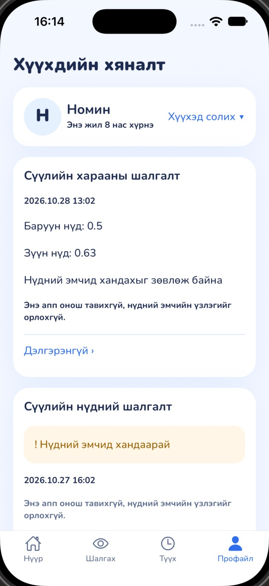
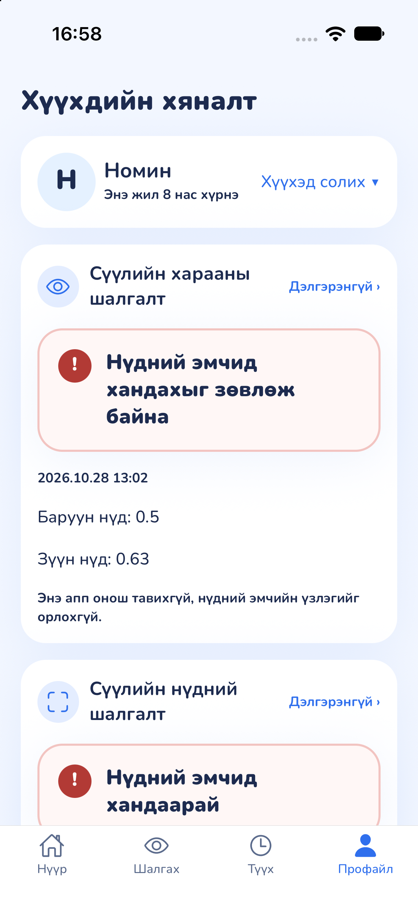
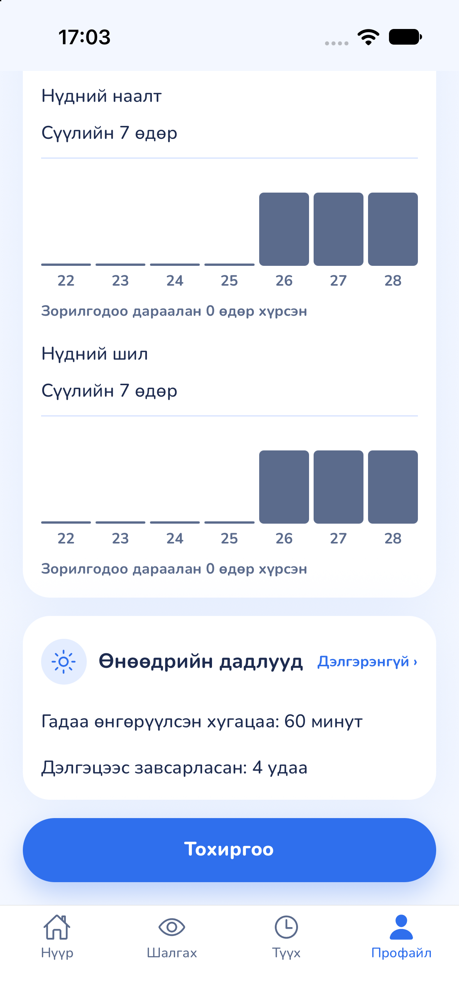
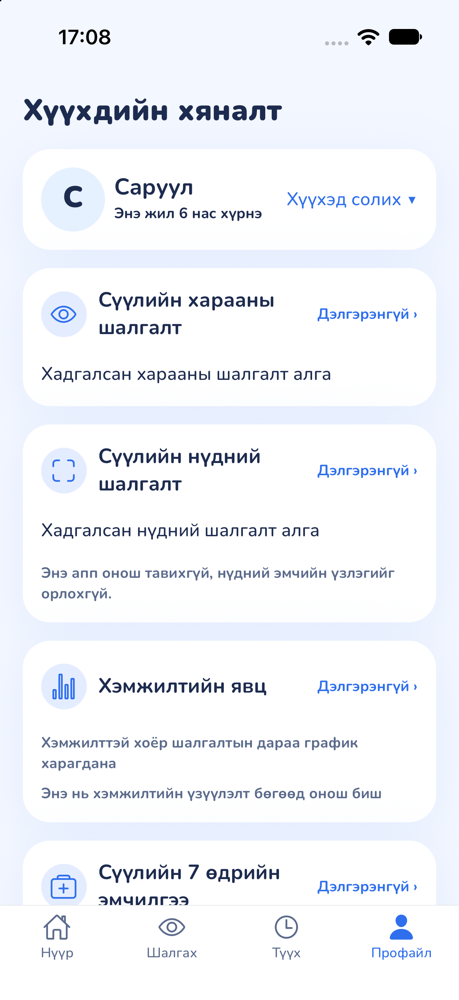
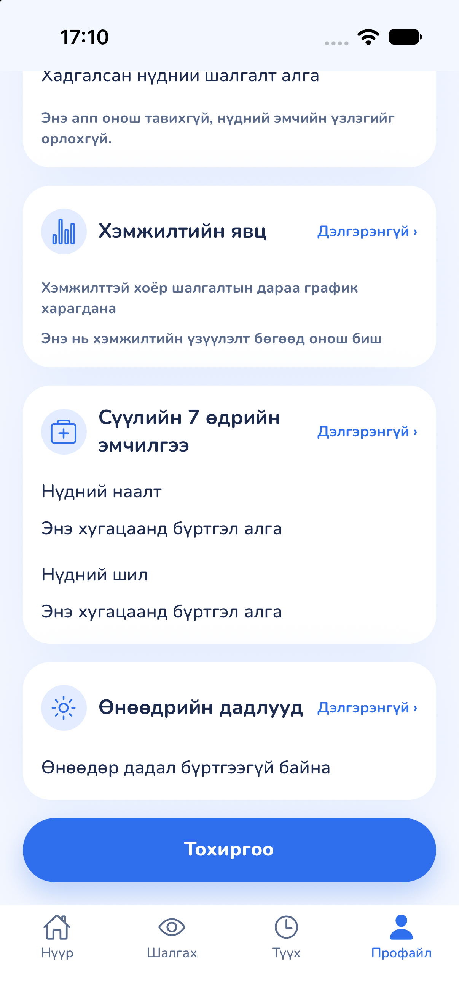

# Profile dashboard review — #231

Native captures from an iPhone 17 simulator, iOS 27.0, Release configuration,
2026-10-28. All names and records shown here are synthetic fixtures; no real
patient data or eye/face photographs are included.

## Before and after

| Before                                | After                                                        |
| ------------------------------------- | ------------------------------------------------------------ |
|  |  |

The before image is a crop of the Device Hub window containing the simulator
screen. The after images are original simulator PNG captures. Brightness, text
and results have not been edited. Different image resolutions are intentional.
The baseline was `dba1f3b`; native after captures used `25ff083`, before rebasing
onto the team's newer main. The rebase also adopted the updated approved
`acuityCopy.noSign.title`; the stored positive referral shown here is unchanged.

| Recorded treatment and habits    | Empty scan and vision                 | Empty treatment and habits          |
| -------------------------------- | ------------------------------------- | ----------------------------------- |
|  |  |  |

## Review performed

- Selected Nomin (birth year 2018): two scans, the latest with `REFER`, and one
  stored vision check with right 0.5, left 0.63 and `refer: true`.
- Confirmed the vision and scan cards use the shared red referral verdict and
  retain the existing not-a-diagnosis notice and recorded values.
- Reviewed the existing progress chart, three days of patch/glasses entries
  (60/120 minutes), and today's outdoor/screen-break totals (60 minutes/4).
- Switched to Saruul (birth year 2020), with no scan, vision, treatment or habit
  records. Each card showed its existing empty state; Nomin's records did not
  appear under Saruul. The treatment and habit header rows are visible together
  in `after-empty-care.png`.
- Existing destination tests cover child-scoped links. Scan tests cover all four
  stored outcomes, and vision tests cover stored referral/non-referral results,
  null eye measurements, notices and approved verdict titles.

## Validation

- `npm run lint`
- `npm run typecheck`
- `npm test`
- Prettier check on the changed dashboard files and this document.

Data loading, storage, verdict calculation and app navigation destinations are
unchanged. The simulator fixtures are local QA data, not a new app seed flow.
