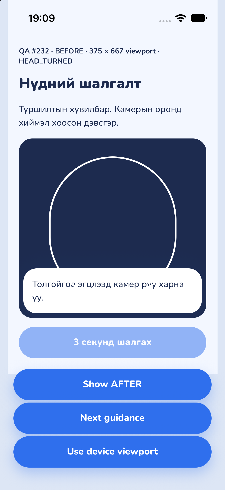
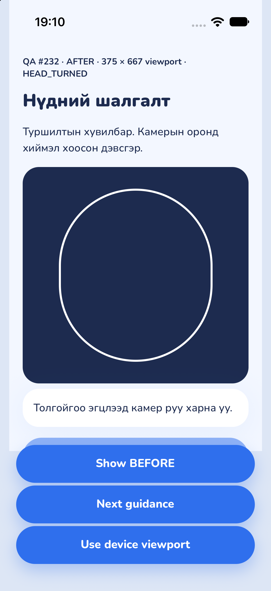
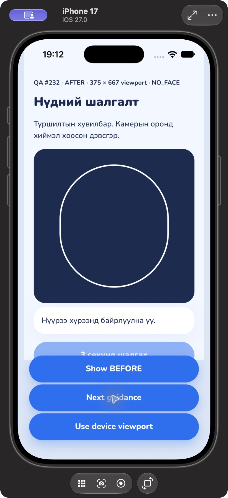
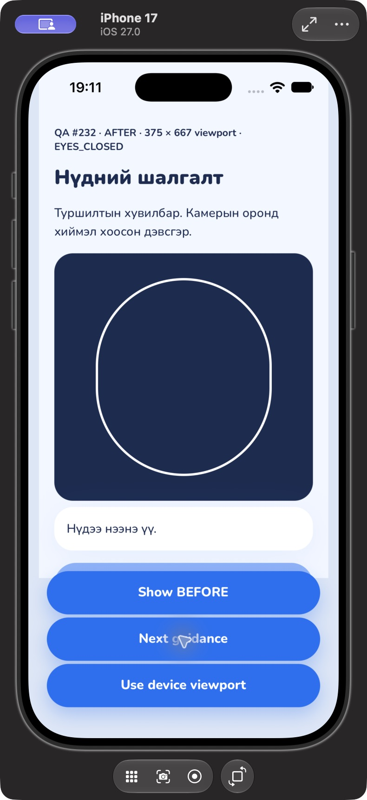
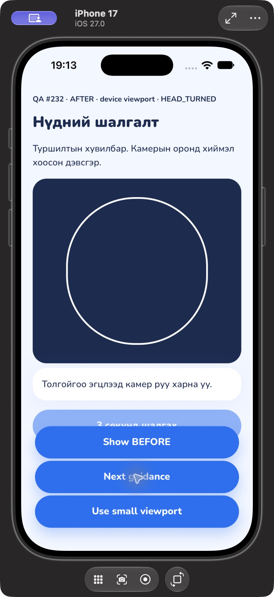

# Live guidance layout review — #232

The text is now in normal document flow below the camera, outside the fixed-height
preview that contains the oval. It can wrap and grow without covering the guide.
The camera viewport, oval dimensions, frame callbacks, guidance copy, smoothing,
reason priority, torch control and recording logic are unchanged.

The user confirmed that this below-camera layout was agreed with `123uugana`
before implementation.

## Simulator evidence

Native iPhone 17 simulator, iOS 27.0, Release, 2026-10-28. These captures use a
**temporary layout fixture**, with a synthetic empty camera background and real
`ScanPreview` / `LiveGuidance` components. No camera inference, face photographs,
model weights or patient data were used. QA controls and labels are fixture-only;
they are not part of the shipped app.

| Before, 375 × 667 viewport  | After, same viewport and guidance |
| --------------------------- | --------------------------------- |
|  |     |

| No face                             | Eyes closed                          | Full device viewport, head turned     |
| ----------------------------------- | ------------------------------------ | ------------------------------------- |
|  |  |  |

The first two files are direct simulator PNGs; the remaining files include the
Device Hub window. Images are unretouched. The 375 × 667 fixture is a constrained
viewport within iPhone 17, **not a booted iPhone SE simulator**. Its scroll view
allows the added guidance card and scan controls to be reached on short screens.

For reproduction, the temporary native entry rendered the existing `Screen`
with a title, preview, guidance and disabled scan button. The before preview used
`ScanPreview` from commit `1868724` with the original `LiveGuidance` positioned
inside it. The after preview used `ScanPreview guidance={<LiveGuidance ... />}`.
Synthetic `LandmarkFrame` inputs selected `NO_FACE`, `HEAD_TURNED` and
`EYES_CLOSED`; the latter two used the existing `mockFrameQuality` helper. The
viewport was toggled between 375 × 667 points and the device's full viewport.
The temporary entry override was restored after capture.

## Checks and remaining acceptance

- `npm run lint`, `npm run typecheck`, `npm test`: pass (446 mobile + 178 core).
- Prettier on changed files and `git diff --check`: pass.
- Camera lifecycle/frame-listener regressions pass; guidance tests preserve the
  three messages, smoothing and polite accessibility announcements.
- The layout regression checks that guidance is outside the clipped camera/oval
  region, after it in document order.
- **Pending:** live physical-iPhone overlap check and the smallest supported
  simulator device. Installed runtimes are iOS 27.0 / 27.1; a constrained viewport
  is supplementary evidence and does not complete the SE-device requirement.
- Keep #232 open until those device checks are recorded.
