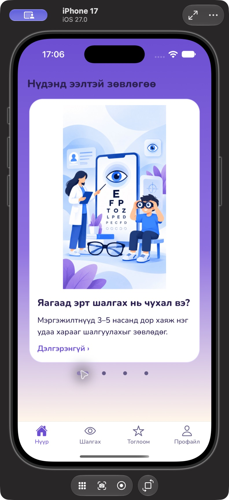
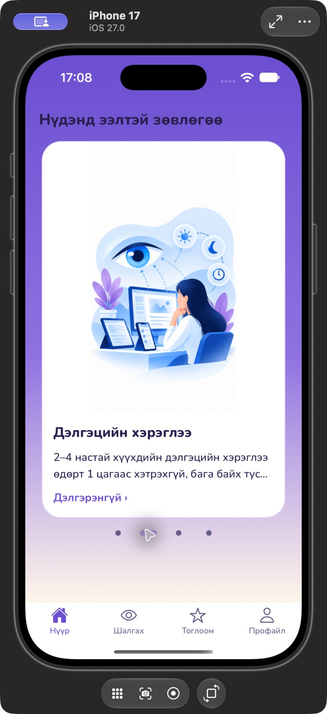
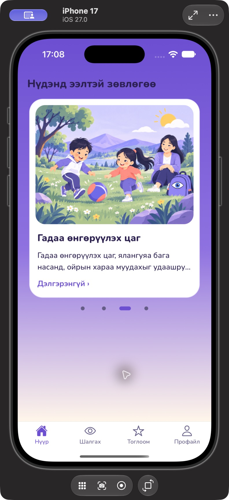
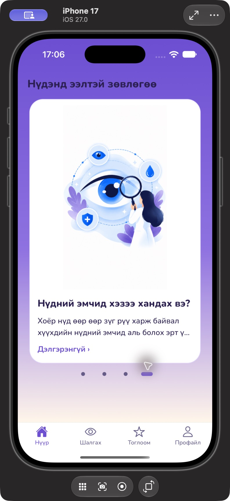

# Home advice native review (#265)

Captured 2026-10-29 from the ordinary Release app through Xcode and Device Hub.
These are native Simulator windows, not HTML recreations. No QA controls or
synthetic screen routes are included in the app.

## Baseline and final branding

The `before-*` images show the Home implementation at `3456b87` (before this
advice integration). During review, the team merged #281 (`64db794`), changing
the shared palette and Home mascot/title. Final images retain that merged
lavender theme and Нүдхэн mascot. Those branding changes are not introduced by
this PR.

| Device                                             | Before                        | Final Home                      | Final carousel                            |
| -------------------------------------------------- | ----------------------------- | ------------------------------- | ----------------------------------------- |
| iPhone 17, iOS 27.0, 402 × 874 pt                  | [Before](before-iphone17.png) | [Home](after-home-iphone17.png) | [Doctor topic](after-doctor-iphone17.png) |
| iPhone SE (3rd generation), iOS 27.0, 375 × 667 pt | [Before](before-se.png)       | [Home](after-home-se.png)       | [Doctor topic](after-doctor-se.png)       |

## Illustrated topics on iPhone 17

| Early checks                              | Screen use                               | Outdoor time                                | Seeking an eye doctor                      |
| ----------------------------------------- | ---------------------------------------- | ------------------------------------------- | ------------------------------------------ |
|  |  |  |  |

The owner reviewed the rounded card and header alignment. Selecting a page control aligns
the advice section below the status bar, avoiding a fragment of the previous
daily card at the top. Free swiping and vertical Home scrolling do not force
that alignment. Directional locking and a stable pager height prevent the two
scroll directions from fighting. The outdoor image uses the supplied landscape variant,
showing the whole sun and less foreground grass. The owner's requested lavender
palette edits are documented in `apps/mobile/assets/illustrations/README.md`.

## Checks

- Xcode Release build and launch succeeded on both Simulator devices above.
- Native review: four topic/page controls, readable summaries and detail action,
  rounded white cards, no portrait stretching and no preceding white-card edge.
- The detail flow was opened natively during integration; full original advice,
  original source links and the not-a-diagnosis notice were present.
- 739 tests passed (561 mobile and 178 core); lint and typecheck passed.
- Tests cover local date/midnight refresh, source/topic routing, image failure,
  empty advice, larger-text wrapping, reduced-motion paging and asset provenance.
- Physical iPhone 12 Pro, iOS 26.6.2: Xcode Release install/launch succeeded;
  the owner confirmed fluid carousel scrolling after the gesture fix.

## Limits

Screenshots show default text size. Larger text and Reduce Motion behavior have
regression-test coverage; a complete manual VoiceOver accessibility audit was
not performed. Daily advice selection uses local calendar dates and no network.
Source links open externally only when selected.
